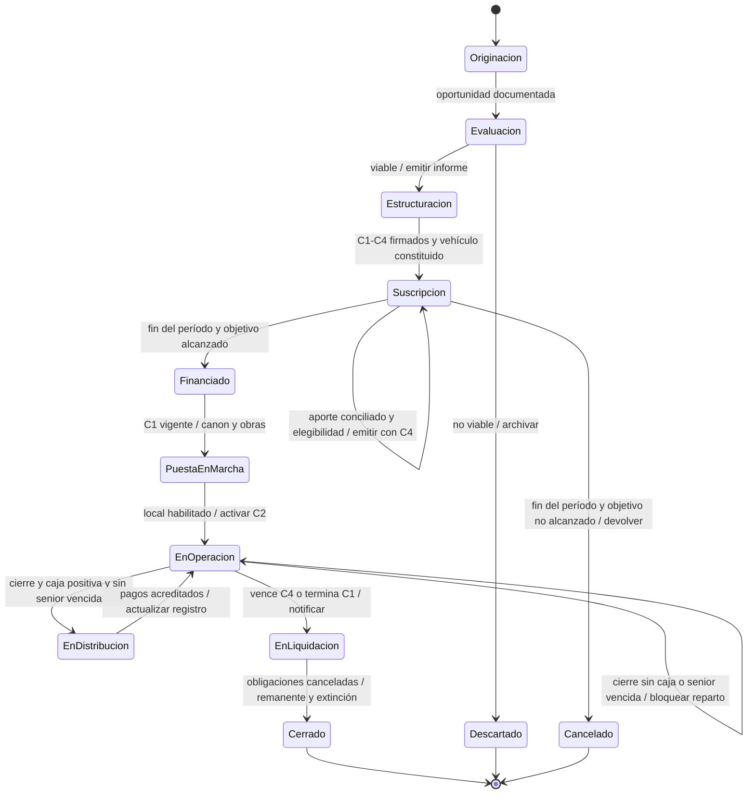
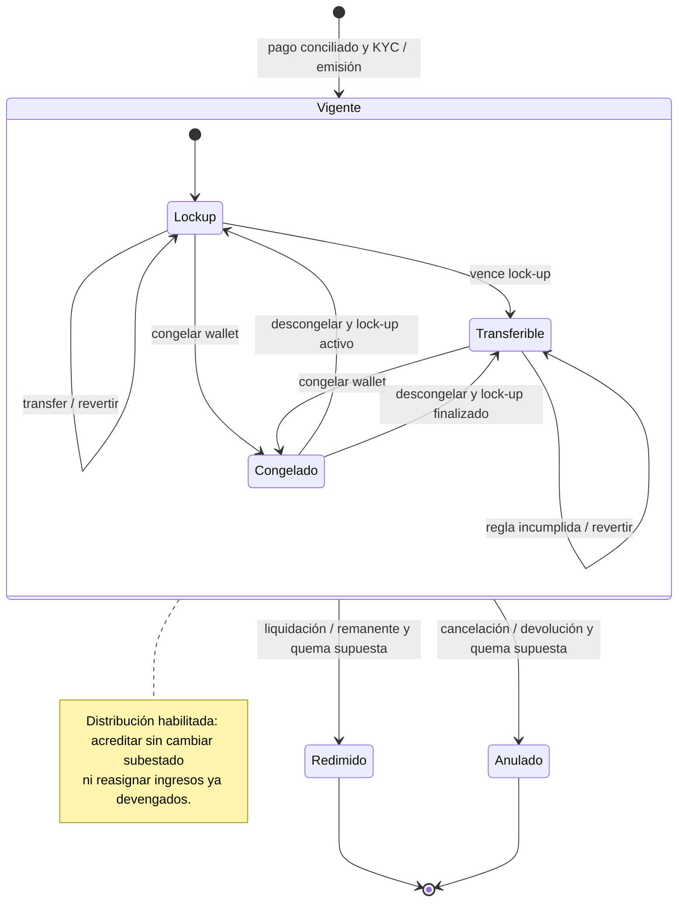

# Ciclos de vida del proyecto y del token

## Ciclo simplificado aprobado para el MVP

El [MVP académico confirmado](MVP-ACADEMICO.md) usa el recorrido siguiente como objetivo de implementación:

| Origen → destino | Evento / guarda | Acción de demostración |
|---|---|---|
| Preparación → Publicada | Administrador publica franquicia de prueba con token identificado | Habilitar compra a USD 10 por token; gas separado. |
| Publicada → Publicada | Compra con términos aceptados y elegibilidad demo | Confirmar pago simulado y emitir una sola vez mediante C4. |
| Publicada → En operación | Administrador marca inicio de operación | Habilitar registro de distribuciones mensuales. |
| En operación → En operación | Distribución mensual positiva y aún no acreditada para esa franquicia/período | Fondear con token de prueba y asignar a prorrata de los saldos al ejecutar. |
| En operación → En operación | Compra habilitada y confirmada | Emitir sin asignar ingresos de distribuciones anteriores. |
| Publicada / En operación → Cerrada | Administrador cierra el proyecto de demostración | Detener nuevas compras/distribuciones; conservar saldos e ingresos ya asignados. No significa liquidación económica. |
| Saldo de ingreso disponible → Cobrado | Titular reclama y se confirma la transacción | Transferir el token de pago de prueba una sola vez por saldo reclamable. |

Los tokens no se transfieren entre inversores en esta versión. La restricción debe cubrir transfer y transferFrom y permitir emisión y reclamos. El mes puede simularse para la presentación; no se exige un scheduler. Una distribución asigna ingresos y el reclamo los paga: son eventos diferentes.

Los DTE completos conservados a continuación son referencia del modelo futuro. Sus campañas, lock-up transferible, devoluciones, liquidación y quema económica no son requisitos de entrega del MVP. Estos estados documentados no implican una implementación nueva.

## DTE completos de referencia

Actualizado: 2026-11-01. Transcripción funcional de los [dos DTE recibidos](source/README.md). Notación: evento `[condición] / acción`. Son reglas del modelo; no implican una máquina de estados implementada. Ver [modelo](BUSINESS-LOGIC.md) y [brechas técnicas](IMPLEMENTATION-STATUS.md).

## Proyecto de franquicia

| Origen → destino | Evento / guarda | Acción |
|---|---|---|
| Inicio → Originación | Inicio | Identificar marca y unidad. |
| Originación → Evaluación | Oportunidad documentada | Solicitar evaluación económica y escenarios. |
| Evaluación → Estructuración | Fin de evaluación y proyecto viable | Emitir informe y definir vehículo y contratos. |
| Evaluación → Descartado | Fin de evaluación y proyecto no viable | Emitir informe y archivar oportunidad; salida anticipada. |
| Estructuración → Suscripción | C1–C4 firmados y fideicomiso constituido | Publicar oportunidad; C4 individual se acepta antes de cada emisión. |
| Suscripción → Suscripción | Aporte recibido; KYC vigente y límites de tenencia cumplidos | Registrar aporte y emitir tokens tras conciliación externa mediante C4. |
| Suscripción → Financiado | Fin del período y objetivo alcanzado | Cerrar suscripción; fondos en el fideicomiso. |
| Suscripción → Cancelado | Fin del período y objetivo no alcanzado | Devolver aportes; salida anticipada. |
| Financiado → Puesta en marcha | C1 vigente | Pagar canon y obras; gestionar equipamiento, permisos y preapertura. |
| Puesta en marcha → En operación | Local habilitado | Activar C2 con la operadora. |
| En operación → En operación | Venta al cliente | Registrar cobro. |
| En operación → En distribución | Cierre de período; caja distribuible > 0 y ninguna obligación senior vencida | Conciliar, reportar y aplicar prelación de pagos. |
| En operación → En operación | Cierre de período; sin caja distribuible o alguna obligación senior vencida | Conciliar, reportar, bloquear distribución y constituir reservas según reglas. |
| En distribución → En operación | Pagos acreditados | Actualizar registro de titulares. |
| En operación → En liquidación | Vence plazo C4 o termina C1 | Notificar inversores y cancelar obligaciones. |
| En liquidación → Proyecto cerrado | Obligaciones canceladas | Distribuir remanente y extinguir fideicomiso; cierre normal. |

El DTE diferencia fin anticipado de cierre normal; el Mermaid usa nodos finales para los tres, conservando esa distinción en nombres y tabla. No agrega cancelaciones arbitrarias desde cualquier etapa. El token tiene una salida por «proyecto cancelado», pero los motivos adicionales de cancelación del proyecto no están definidos en el DTE.

## Token emitido a un inversor

**Vigente** es un estado compuesto: contiene En lock-up, Transferible y Congelado. En cualquiera de ellos el titular conserva los derechos económicos definidos en C4.

| Origen → destino | Evento / guarda | Acción |
|---|---|---|
| Inicio → Vigente / En lock-up | Pago externo; KYC vigente | Registrar conciliación y emitir al inversor mediante C4. |
| En lock-up → En lock-up | `transfer()` con lock-up activo | Revertir. |
| En lock-up → Transferible | Vence plazo de lock-up | Habilitar transferencias ordinarias sujetas al resto de controles. |
| Transferible → Transferible | `transfer()` / `transferFrom()`; reglas cumplidas | Mover tokens y actualizar titular. |
| Transferible → Transferible | Intento de transferencia; alguna regla incumplida | Revertir sin cambiar titular ni saldo. |
| En lock-up → Congelado | Congelar wallet; KYC vencido u orden de autoridad | Bloquear operaciones según facultades y procedimiento. |
| Transferible → Congelado | Congelar wallet; KYC vencido u orden de autoridad | Bloquear operaciones según facultades y procedimiento. |
| Congelado → En lock-up | Descongelar; KYC renovado y lock-up activo | Retirar congelamiento y mantener restricción temporal. |
| Congelado → Transferible | Descongelar; KYC renovado y lock-up finalizado | Retirar congelamiento; siguen vigentes las otras reglas. |
| Vigente → Vigente | Distribución periódica; caja distribuible > 0 y ninguna senior vencida | Acreditar al titular de ese momento; no reasignar derechos ya devengados por una transferencia posterior. |
| Vigente → Redimido | Liquidación del fideicomiso | Pagar remanente y quemar, bajo el supuesto señalado abajo; cierre normal. |
| Vigente → Anulado | Proyecto cancelado | Devolver aporte y quemar, bajo el supuesto señalado abajo; salida anticipada. |

Las salidas desde Vigente y su distribución periódica aplican a todos sus subestados, incluido Congelado. Una asignación de ingresos reclamables no equivale a un pago efectivo al inversor.

## Reglas y límites de interpretación

- El DTE enumera KYC vigente de ambas partes, wallets no congeladas, país permitido, tenencia ≤ máximo, inversores ≤ máximo y lock-up terminado. Es la regla esperada para `transfer` y `transferFrom`; el código tiene diferencias documentadas en [estado técnico](IMPLEMENTATION-STATUS.md).
- El vencimiento KYC es una condición para congelar en el modelo, no evidencia de una tarea automática que ejecute ese congelamiento. Una orden de autoridad tampoco se levanta automáticamente por renovar KYC: su resolución y autoridad de descongelamiento quedan pendientes.
- Terminar lock-up habilita temporalmente la transferencia; no garantiza que pase KYC u otros controles ni que haya compradores. En el código se consulta un timestamp, sin transacción automática de cambio de estado.
- **Quema al cancelar/cerrar: supuesto explícito del DTE.** El PDF no documenta esa secuencia económica. Existe `burn` técnico, pero faltan orquestación, autorizaciones, conciliación de devoluciones/remanentes y tratamiento de ingresos aún reclamables. No declarar «redimido» por observar solo una quema.
- El corte económico por período y la fórmula jurídica de C4 no están definidos. La preservación de ingresos ya asignados por el token no sustituye ese corte.
