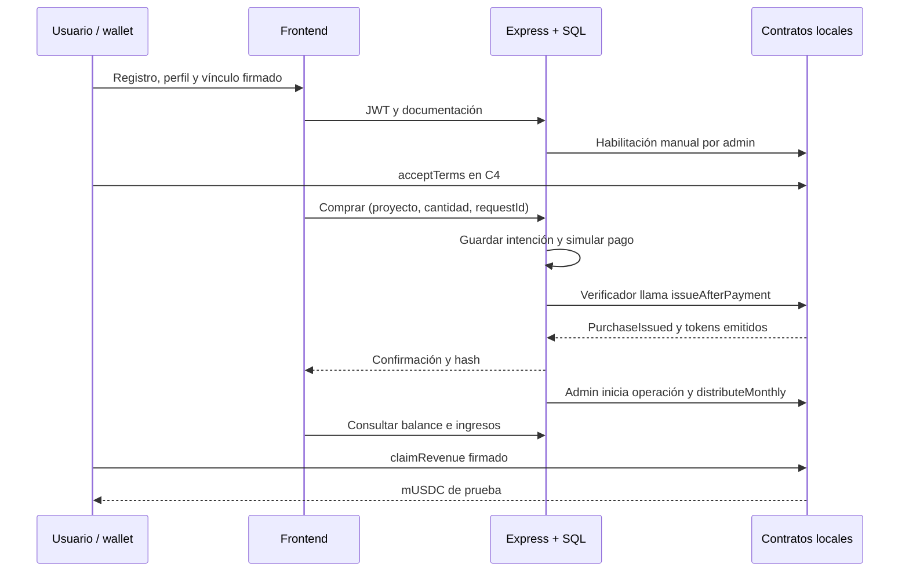

# MVP académico de FranToken — alcance vigente

Actualizado: 2026-11-02. Alcance confirmado por el usuario; implementación integrada en frontend, Express y Hardhat local. Este documento prevalece para la demo sobre los requisitos de operación real de BUSINESS-LOGIC.md y LIFECYCLES.md. [Estado técnico](IMPLEMENTATION-STATUS.md).

## Definiciones confirmadas

| ID | Regla del MVP |
|---|---|
| MVP-01 | Compra con pago simulado y emisión real en la cadena local. Sin cobro bancario. |
| MVP-02 | El administrador inicia la operación; recién entonces se distribuyen ingresos. |
| MVP-03 | Períodos mensuales; importe positivo cargado y fondeado manualmente. Se pueden simular meses. |
| MVP-04 | Prorrata según balances al ejecutar el reparto. El titular firma el cobro; sin retorno fijo. |
| MVP-05 | Transferencias ordinarias entre inversores deshabilitadas en el contrato. |
| MVP-06 | Hardhat local, chain ID 31337, y mUSDC de prueba para repartir y cobrar. |

Precio: **USD 10 por token entero**, representado en C4 como 1000 centavos USD (dos decimales). Los ingresos usan **mUSDC con seis decimales**: 30 mUSDC = 30000000 unidades mínimas. Ambas escalas se conservan como enteros/texto; no usar los decimales de mUSDC para calcular el precio C4. El gas se informa por separado en ETH de prueba. El 0,5 % de C3 sigue siendo un ejemplo de cálculo, sin comisión comercial definitiva ni cobro real.

## Usuarios, documentación y permisos

Cualquier cuenta registrada puede invertir **y** presentar una franquicia. El rol técnico `investor` por defecto no excluye ser solicitante; no se exige un rol franquiciado distinto. Solo `superadmin` revisa documentación, admite/publica emisiones y ejecuta repartos. El creador gestiona la operación de sus propias franquicias y propone ingresos para revisión interna. El rol `admin` anterior queda como legado sin privilegios globales. Elegir un rol en el navegador o vincular una wallet no otorga esos permisos.

El perfil requiere nombre, DNI, CUIL, fecha de nacimiento válida y no futura, país, provincia, ciudad, dirección y código postal; teléfono y preferencia de novedades completan el formulario. Son campos de texto, sin carga de archivos ni proveedor KYC. Usar exclusivamente datos ficticios en la demo. Se guardan en SQL y se exponen al propio usuario y a administración; no se publican en el catálogo ni en blockchain. La habilitación manual denominada `kycApproved` no certifica una identidad legalmente.

Para invertir: perfil completo, wallet vinculada mediante desafío firmado, aprobación manual del administrador y términos C4 aceptados por esa wallet. Cambiar datos de identidad revoca la aprobación de nuevas compras en Express y exige nueva revisión. No borra tokens ni ingresos previos. Una wallet con compras pendientes o confirmadas no se cambia por el flujo normal del MVP; no se implementa migración de patrimonio entre cuentas.

Para presentar una franquicia alcanza el perfil completo: no se exige poseer tokens, tener historial financiero ni vincular una wallet. El administrador revisa cada solicitud antes de publicarla. Es una evaluación académica, no una apertura comercial o permiso de marca acreditado.

## Solicitud y publicación

Formulario: nombre, sector libre, ciudad, país, inversión estimada y moneda USD/ARS, operador, mes estimado de apertura y descripción. El historial de tres ejercicios es opcional y no integra el formulario mínimo. El costo estimado de la solicitud no se convierte automáticamente en cupo de emisión ni en rentabilidad.

Estados: **Enviada → Aprobada / Observada → Publicada**. Las observaciones y el historial se ven en «Mis solicitudes». El creador puede corregir y reenviar su solicitud mientras no se haya reservado su publicación; cada corrección vuelve a Enviada e invalida una aprobación previa. La reserva de publicación y los datos ya publicados quedan protegidos. El ID y el estado se reciben del backend, no se inventan en la UI.

Al publicar, el administrador define símbolo y cupo entero de prueba (1 a 1000000). Express reserva un proyecto estable y solicita a la fábrica crear su token académico y C4. Configura C4 como controlador/agente, publica el token y entrega administración a la cuenta técnica. Solo entonces aparecen sus contratos en el catálogo. Reintentar con la misma solicitud/símbolo/cupo recupera la publicación; otro contenido se rechaza. No se inventa ROI para los nuevos proyectos.

## Compra y cobro

Express es el coordinador único: autentica JWT, autoriza admin y conserva compras/distribuciones. Next presenta los datos y la wallet firma vínculo, aceptación y cobro. `/api/mvp` y las escrituras antiguas `/api/blockchain/*` responden **410** para impedir recorridos alternativos. No existe fallback que convierta un fallo de cadena en una compra ficticia en SQL.

La referencia de compra se guarda antes del envío. Purchase conserva intención y hash; un reintento consulta `PurchaseIssued` antes de volver a emitir, incluso si luego se revoca la aprobación para comprar. El botón de recuperación mantiene cantidad y referencia y permite consultar compras que agotaron el cupo. La misma referencia con otro contenido se rechaza. La cola de escrituras evita competir por nonces en la única instancia Express del MVP; los contratos conservan unicidad de compra/período.

La distribución usa una clave única proyecto/mes en SQL y contrato. El administrador hace `approve` y luego `distributeMonthly(YYYYMM, amount)`; asignación y marca del mes son atómicas dentro de la segunda transacción. Un reintento recupera el evento; otro importe para el mismo mes se rechaza. La oferta del corte se obtiene del evento, no de una cifra estimada en la base.

La franquicia pasa Draft → Published → Operating → Closed (también puede cerrar desde Published). No se reabre. Published/Operating admiten compras; solo Operating reparte. Closed conserva el cobro de ingresos asignados. Una compra posterior no participa en repartos anteriores. El titular puede retirar varios meses acumulados; no se promete cobro aislado por mes. Hay redondeo entero y posibles residuos. Pausa o congelamiento impiden el cobro mientras estén vigentes; el cierre por sí solo no.

## Límites y criterios de aceptación

La demo debe permitir registro/perfil, compra C4, respuesta perdida sin doble emisión, publicación de una solicitud nueva, dos titulares a prorrata, reparto mensual único, compra posterior sin ingresos retroactivos y cobro sin repetición. Debe rechazar acciones admin de un usuario común, falta de documentación/términos, transferencias ordinarias y reparto fuera de operación.

Fuera de alcance: bancos, KYC real, retornos garantizados, metas de campaña/devoluciones, balances e impuestos, liquidación económica, cascada completa C1–C3, sustitución de operadora, mercado secundario y automatización por calendario. C3 se firma con cuentas de prueba para satisfacer C4; C1/C2 permanecen como ejemplos del modelo completo. Las decisiones pendientes de [DECISIONS.md](DECISIONS.md) siguen abiertas para valor real. No se agregan proveedores, redes públicas ni una aprobación jurídica.

## Gestión por creador y superadmin

Actualización aprobada por el usuario el 2026-11-03: el creador puede gestionar la operación y cerrar sus propias franquicias publicadas; el superadmin tiene acceso global, incluidos los proyectos ilustrativos sin creador. La admisión y publicación de la emisión inicial son exclusivas del superadmin. El alta interna es explícita, sin contraseña pública ni promoción automática de usuarios.

Los creadores proponen mes e importe de reparto; el superadmin observa o ejecuta usando los fondos técnicos de prueba. Proponer no acredita ni paga ingresos. Una propuesta iniciada queda inmutable hasta conciliar; se reutiliza la unicidad de franquicia/período para impedir duplicados. Se conserva el cierre terminal, el cobro individual y la ausencia de reventa. No se modifican los contratos ni los roles jurídicos del modelo completo.
